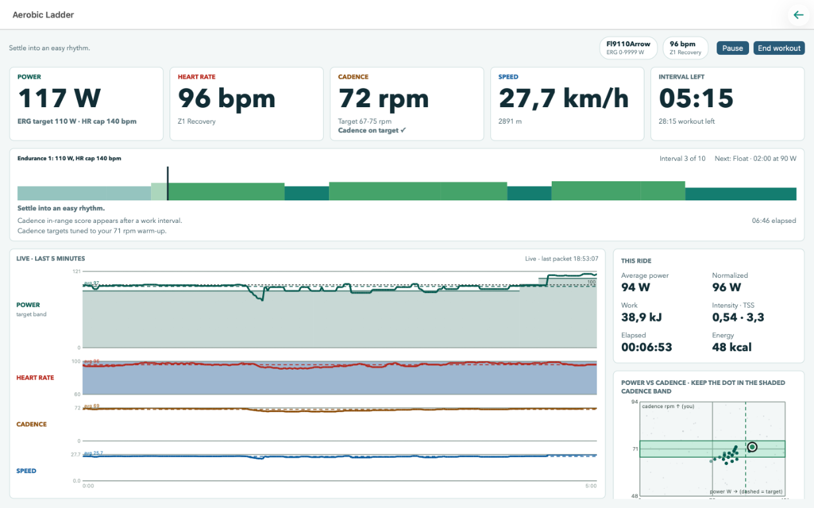
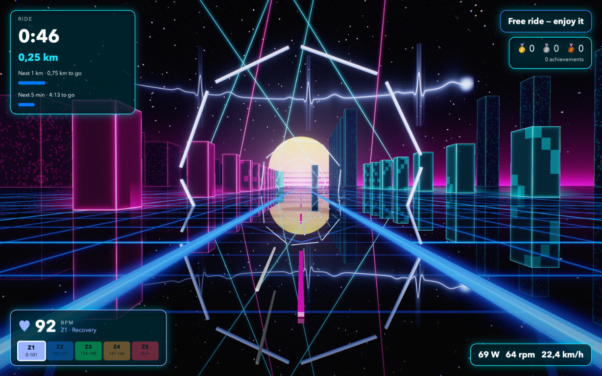

# Stationary

**Beta software:** Stationary is under active development. Features may change, and bugs or data loss are possible. Back up important ride data.

Stationary is an indoor cycling app for macOS. Connect a Bluetooth Fitness Machine Service (FTMS) bike or smart trainer to ride, follow workouts and track your progress.



## Ride and train

- Enjoy free rides, structured workouts and training plans, with power- and heart-rate-guided sessions.
- Estimate your functional threshold power (FTP) with a ramp test and use it to scale workout targets.
- Follow live power, heart rate, cadence and speed, and control power or resistance when your machine supports it.
- Save rides with recorded effort locally, review results and ride history, and export data as CSV.
- Open an optional 3D ride scene with achievements, including on a second display.

The 3D ride scene turns your effort into a neon track. Cadence drives the beat, heart rate pulses the sky, and staying on target earns medals and milestones:



More screenshots: [Home](assets/screenshots/home.png) and [results](assets/screenshots/results-analysis.png).

## Getting started

[Download Stationary Beta for Apple silicon Macs](https://antaoalmada.dev/Stationary/). Requires macOS 14.0 or later. The DMG is ad-hoc signed, without Apple notarization; macOS may require a per-app security exception. See the [installation instructions](https://antaoalmada.dev/Stationary/support.html) and [release process](RELEASING.md).

Use a Mac with a Bluetooth FTMS-compatible bike or trainer, and optionally a Bluetooth heart-rate sensor. You can also start a free ride with just a heart-rate sensor. Structured workouts and the FTP ramp test require a machine that supports power control; heart-rate-guided workouts also require a heart-rate sensor.

1. On Home, pair your fitness machine or heart-rate sensor (or both).
2. For power-based training, set your FTP in Settings, or complete the ramp test and accept the estimate in Results.
3. Start a free ride, workout or ramp test. Open Results to review your ride or export the data.

For power-reporting indoor bikes, speed and distance are estimates based on power rather than the bike's readings.

**Safety:** Workout targets are guidance, not medical advice, and heart-rate limits are not medical monitoring. Some trainers may retain resistance after an abrupt stop, even with stall protection.

### Run from source

The app currently targets Mac Catalyst. Install [Xcode](https://developer.apple.com/xcode/) and the [.NET SDK](https://dotnet.microsoft.com/download) version specified in [`global.json`](global.json), then run these commands on an Apple silicon Mac:

```bash
git clone https://github.com/aalmada/Stationary.git
cd Stationary
dotnet workload install maui-maccatalyst
dotnet restore Stationary.slnx
dotnet build src/Stationary.Ftms.Dashboard/Stationary.Ftms.Dashboard.csproj \
  -f net11.0-maccatalyst -r maccatalyst-arm64 --no-restore \
  -p:ValidateXcodeVersion=false
dotnet build src/Stationary.Ftms.Dashboard/Stationary.Ftms.Dashboard.csproj \
  -t:Run -f net11.0-maccatalyst -r maccatalyst-arm64 --no-restore \
  -p:ValidateXcodeVersion=false
```

On an Intel Mac, replace both occurrences of `maccatalyst-arm64` with `maccatalyst-x64`.

## Contributing

[Report an issue](https://github.com/aalmada/Stationary/issues) or [contribute a pull request](https://github.com/aalmada/Stationary/pulls).

### Agent-first development

Stationary is an agent-first codebase: all of its source code was generated with [GitHub Copilot](https://github.com/features/copilot). Contributors are encouraged to work the same way:

- [AGENTS.md](AGENTS.md) files give agents the commands, conventions and guardrails for each area.
- Agent skills come from [Intelligentium.ai](https://intelligentium.ai) and are installed with [APM](https://github.com/microsoft/apm) from [apm.yml](apm.yml). Change dependencies there and let APM regenerate `apm.lock.yaml`.

### How it's built

- **[.NET 11](https://dotnet.microsoft.com/)**: every project targets `net11.0`, with nullable reference types, analyzers and warnings as errors enabled.
- **[.NET MAUI](https://dotnet.microsoft.com/apps/maui)**: the cross-platform UI framework for the app, which currently ships for Mac Catalyst.
- **[Reactive Extensions (Rx.NET)](https://github.com/dotnet/reactive)**: observable pipelines merge, sample and schedule Bluetooth connections, telemetry, heart rate and Control Point responses, so the UI always shows the latest data.
- **[ReactiveUI](https://www.reactiveui.net/)**: reactive MVVM with source-generated properties and `ReactiveCommand`s. View models live in a portable library, so they're tested without the app.
- **[Silk.NET](https://github.com/dotnet/Silk.NET)**: Vulkan bindings for the 3D ride scene, running on Metal through MoltenVK. It renders on a dedicated thread with HDR, reflections, bloom and tone mapping.

Workout execution is a pure reducer in the dashboard core.

### Project layout

- [Dashboard](src/Stationary.Ftms.Dashboard/): the Mac Catalyst app.
- [Dashboard core](src/Stationary.Ftms.Dashboard.Core/) and [view models](src/Stationary.Ftms.Dashboard.ViewModels/): ride and training logic and reactive presentation.
- [FTMS](src/Stationary.Ftms/), [FTMS client](src/Stationary.Ftms.Client/), [Bluetooth](src/Stationary.Ble/) and [heart rate](src/Stationary.HeartRate/): codecs, connectivity and device analytics.
- [Tests](tests/) and [benchmarks](benchmarks/): automated checks and performance measurements.

### Build and test

On macOS, with the prerequisites above:

```bash
dotnet restore Stationary.slnx
dotnet build Stationary.slnx --no-restore -p:ValidateXcodeVersion=false
dotnet test --solution Stationary.slnx --no-restore
dotnet format Stationary.slnx --verify-no-changes --no-restore
```

On Linux, use the solution filter that excludes the Mac Catalyst app:

```bash
dotnet restore Stationary.CI.slnf
dotnet build Stationary.CI.slnf --no-restore
dotnet test --solution Stationary.CI.slnf --no-build
```

ReactiveUI is pinned for trimmed Mac Catalyst compatibility; check the app build when upgrading it. See the [development commands and conventions](AGENTS.md) and the [FTMS reference](docs/ftms/index.md).
